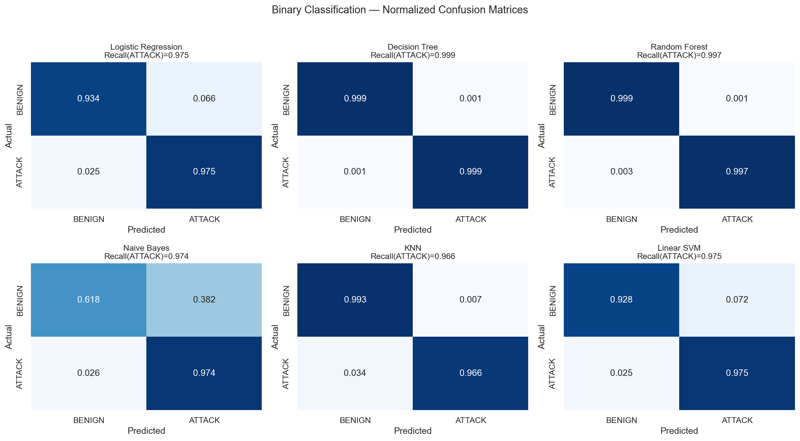
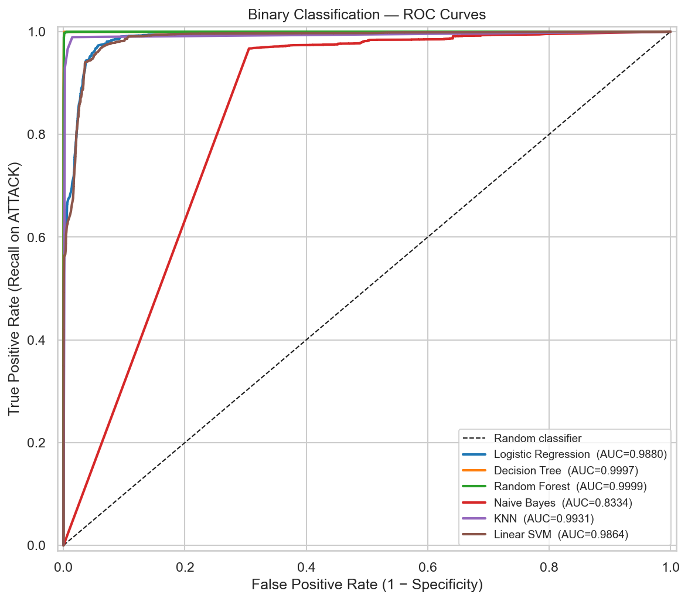
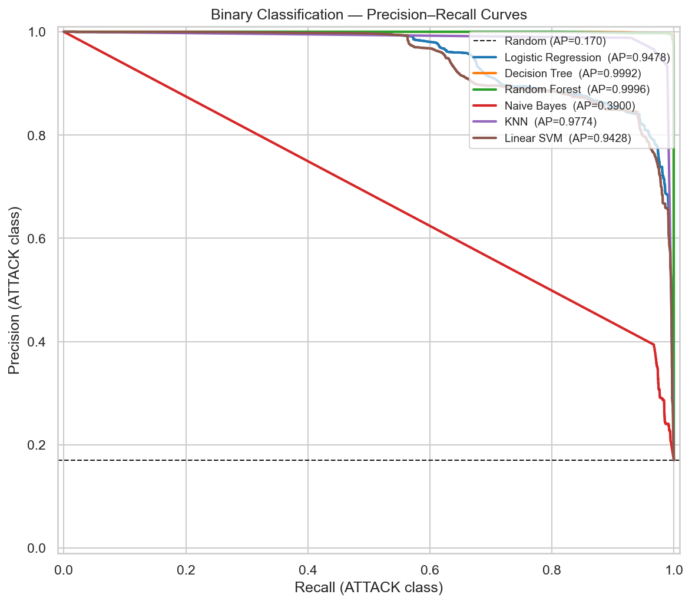
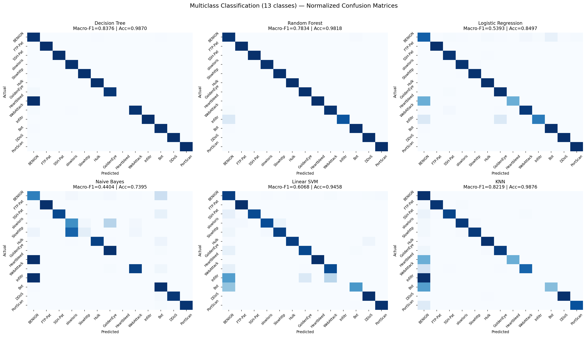
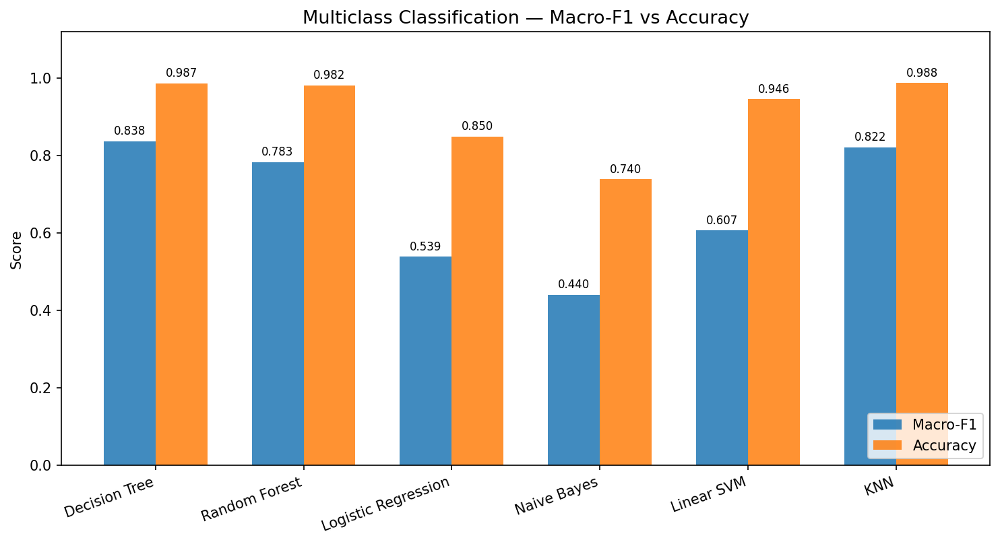
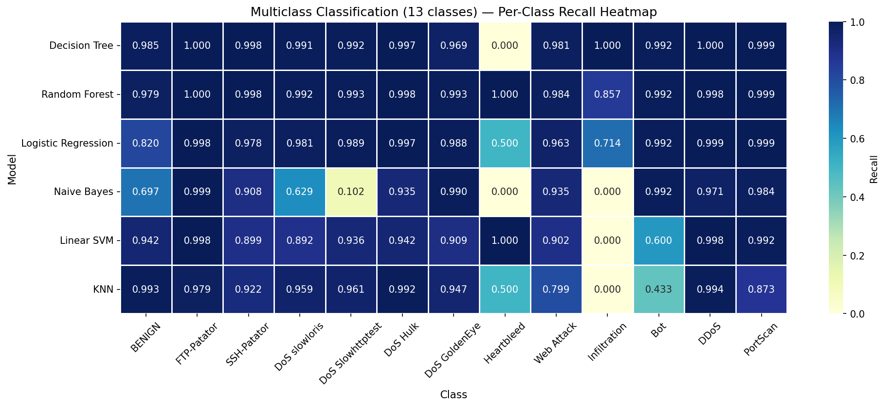
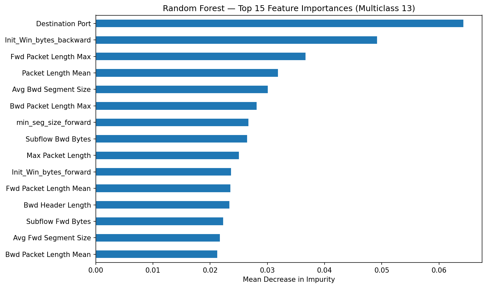

# Network Attack Detection Using Machine Learning

[](https://www.python.org/)
[](https://scikit-learn.org/)
[](https://unb.ca/cic/datasets/ids-2017.html)
[]()

A comprehensive, production-grade Machine Learning benchmark for **Network Intrusion Detection Systems (NIDS)** evaluated on the [CIC-IDS-2017](https://unb.ca/cic/datasets/ids-2017.html) benchmark dataset.

The system addresses two complementary security tasks:
1. **Task 1 — Binary Classification**: Differentiating `BENIGN` network traffic from malicious `ATTACK` flows.
2. **Task 2 — Multiclass Classification**: Granular categorization across **13 traffic classes** (BENIGN + 12 attack categories after merging Web Attack sub-types).

---

## 📌 Table of Contents
1. [Pipeline Architecture](#-pipeline-architecture)
2. [Dataset & Rigorous Preprocessing](#-dataset--rigorous-preprocessing)
3. [Task 1 — Binary Classification Results](#-task-1--binary-classification-results)
4. [Task 2 — Multiclass Classification Results (13 Classes)](#-task-2--multiclass-classification-results-13-classes)
5. [Conflicting Labels Analysis](#-conflicting-labels-analysis)
6. [Reproducibility Guide](#-reproducibility-guide)
7. [Limitations & Threat Model](#-limitations--threat-model)
8. [Project Structure](#-project-structure)

---

## 🧠 Pipeline Architecture

```text
========================================================================================
                                CIC-IDS-2017 RAW CSVs (8 files)
                                  2,830,743 flows × 79 features
========================================================================================
                                             │
                        ┌────────────────────┴────────────────────┐
                        │ Phase 1: Preprocessing & Data Hygiene   │
                        └────────────────────┬────────────────────┘
                                             │
               • Strip trailing/leading column whitespace
               • Fix Thursday WebAttacks encoding (latin-1 + label normalization)
               • Convert Inf / -Inf to NaN, drop 2,867 corrupted rows
               • Drop 8 constant/zero-variance columns
               • Exact deduplication: remove 329,691 duplicates (11.7% of data)
               • Stratified 80/20 train-test split (seed=42) on 15 original classes
               • Near-zero variance filter fitted on X_train only (66 final features)
               • StandardScaler fitted on X_train only (reused across all tasks)
                                             │
                        ┌────────────────────┴────────────────────┐
                        │      Cached Dataset: cache/splits.npz    │
                        │    X_train: (1,998,548, 66) float32     │
                        │    X_test:    (499,637, 66) float32     │
                        └────────────────────┬────────────────────┘
                                             │
                    ┌────────────────────────┴────────────────────────┐
                    │                                                 │
  ┌─────────────────▼─────────────────┐             ┌─────────────────▼─────────────────┐
  │ Phase 2: Binary Classification    │             │ Phase 3: Multiclass Classification │
  │        (BENIGN vs ATTACK)         │             │      (13 traffic classes)         │
  │ • Decision Tree (full train)      │             │ • Decision Tree (full train)      │
  │ • Random Forest (full train, bnd) │             │ • Random Forest (full train, bnd) │
  │ • Logistic Regression (full train)│             │ • Logistic Regression (full train)│
  │ • Naive Bayes (100k subsample)    │             │ • Naive Bayes (100k subsample)    │
  │ • Linear SVM (100k subsample)     │             │ • Linear SVM (100k subsample)     │
  │ • KNN k=3 (100k prototypes)       │             │ • KNN k=3 (100k prototypes)       │
  │   -> Full test eval (499,637 rows)│             │   -> Full test eval (499,637 rows)│
  └───────────────────────────────────┘             └───────────────────────────────────┘
```

---

## 📊 Dataset & Rigorous Preprocessing

The [CIC-IDS-2017](https://unb.ca/cic/datasets/ids-2017.html) dataset comprises bidirectional network flows captured over 5 days (Monday to Friday).

### Data Hygiene & Sanitization
* **Encoding fix**: The Thursday WebAttacks CSV contained corrupt characters in label strings (`Web Attack  Brute Force`, `Web Attack  XSS`). Resolved via `encoding='latin-1'` with normalization stripping non-alphabetic noise.
* **Exact Deduplication**: 329,691 exact duplicates (identical 66-feature vectors and identical labels) were removed (11.7% reduction). The raw CSVs contain extracted flow features without IP addresses, port numbers, or timestamps; duplicate flows represent repeated identical transactions or capture artifacts.
* **Strict Leakage Prevention**:
  * Near-zero variance feature filtering is evaluated strictly on `X_train`.
  * `StandardScaler` is fitted solely on `X_train` (1,998,548 rows) and applied without refitting to `X_test`.
* **Clean Dataset Dimensions**:
  * **2,498,185 total flows × 66 engineered network features**.
  * **Training set**: 1,998,548 flows (80%).
  * **Test set**: 499,637 flows (20%), stratified by class distribution.

---

## 🛡️ Task 1 — Binary Classification Results

The primary operational goal of binary network intrusion detection is **maximizing attack recall** (minimizing undetected intrusions) while maintaining an acceptable **False Alarm Rate (FAR)** on benign operations.

### Binary Benchmark Table
*All 6 models are evaluated on the exact same full test set of **499,637 flows** (85,148 attacks, 414,489 benign).*

| Model | Training Rows | Evaluated Test Rows | Attack Recall | Attack Precision | Attack F1 | Overall Accuracy | ROC-AUC | PR-AUC | False Alarm Rate (FAR) | Fit Time (s) | RAM Δ (GB) |
|---|---|---|---|---|---|---|---|---|---|---|---|
| **Random Forest** | 1,998,548 | 499,637 | 0.9969 | **0.9932** | 0.9950 | 0.9983 | **0.9999** | **0.9996** | **0.0014** (0.14%) | 264.2 | +0.02 |
| **Decision Tree** | 1,998,548 | 499,637 | **0.9994** | 0.9931 | **0.9962** | **0.9987** | 0.9997 | 0.9992 | **0.0014** (0.14%) | 120.0 | +0.10 |
| **KNN (k=3)** | 100,000 | 499,637 | 0.9665 | 0.9662 | 0.9664 | 0.9885 | 0.9931 | 0.9774 | 0.0069 (0.69%) | **0.1** | +0.00 |
| **Logistic Regression** | 1,998,548 | 499,637 | 0.9753 | 0.7525 | 0.8495 | 0.9411 | 0.9880 | 0.9478 | 0.0659 (6.59%) | 45.0 | +0.05 |
| **Linear SVM** | 100,000 | 499,637 | 0.9747 | 0.7366 | 0.8391 | 0.9363 | 0.9864 | 0.9428 | 0.0716 (7.16%) | 13.1 | +0.00 |
| **Gaussian Naive Bayes** | 100,000 | 499,637 | 0.9738 | 0.3437 | 0.5081 | 0.6787 | 0.8334 | 0.3900 | 0.3819 (38.19%) | **0.1** | +0.00 |

### Why Linear Models Have Low Precision (~75%) Despite High Recall (~97.5%)
Logistic Regression and Linear SVM achieve ~97.5% overall attack recall but only ~74–75% attack precision. Their linear decision boundaries cannot separate stealthy attacks (Web Attacks, Bot traffic) that mimic normal HTTP flows in feature space—these models compensate by flagging BENIGN flows as attacks, generating high false-alarm rates (6.59% and 7.16%, or over 27,000 false alarms on benign test flows). This is not a bug but the expected mathematical behavior of linear hyperplanes on non-linearly separable network manifolds, providing empirical justification for non-linear tree ensembles.

### Binary Evaluation Figures

*Figure 1: Normalized confusion matrices for all 6 binary classifiers on 499,637 test flows.*


*Figure 2: Receiver Operating Characteristic (ROC) curves.*


*Figure 3: Precision-Recall (PR) curves emphasizing minority class detection fidelity.*

---

## 🎯 Task 2 — Multiclass Classification Results (13 Classes)

### Class Consolidation & Taxonomy
The original 15 CIC-IDS-2017 classes are consolidated into **13 classes**:
* The 3 Web Attack sub-types (`Web Attack - Brute Force`, `Web Attack - XSS`, `Web Attack - Sql Injection`) are merged into a unified **`Web Attack`** class (1,715 train / 428 test flows). Merging 3 classes into 1 removes 2 labels ($15 - 2 = 13$ classes).
* The 13 final classes and test flow counts: `BENIGN` (414,489), `DoS Hulk` (34,569), `DDoS` (25,603), `PortScan` (18,139), `DoS GoldenEye` (2,057), `FTP-Patator` (1,186), `DoS slowloris` (1,077), `DoS Slowhttptest` (1,046), `SSH-Patator` (644), `Web Attack` (428), `Bot` (390), `Infiltration` (7), `Heartbleed` (2).

### Rare-Class Strategy & Statistical Limitations
* **Heartbleed** (9 train / 2 test flows) and **Infiltration** (29 train / 7 test flows) represent extreme class scarcity in CIC-IDS-2017.
* Main experiment policy: We evaluate all classes without synthetic oversampling (SMOTE is omitted to avoid synthetic artifact injection on high-dimensional manifolds). While Random Forest correctly classifies 2/2 Heartbleed (100% recall) and 6/7 Infiltration (85.7% recall), these scores carry wide confidence intervals and are statistically volatile.

### Multiclass Benchmark Table (13 Classes)
*Evaluated on the full test set of **499,637 flows** across all 13 classes.*

| Model | Train Rows | Test Rows | Accuracy | Macro-F1 | Weighted-F1 | Macro-Recall | Fit Time (s) | Predict Time (s) | RAM Peak |
|---|---|---|---|---|---|---|---|---|---|
| **Decision Tree** | 1,998,548 | 499,637 | 0.9870 | **0.8376** | **0.9893** | 0.9158 | 206.4 s | 1.8 s | 0.91 GB |
| **KNN (k=3)** | 100,000 | 499,637 | **0.9876** | 0.8219 | 0.9876 | 0.7964 | **0.02 s** | 266.1 s | 1.14 GB |
| **Random Forest** | 1,998,548 | 499,637 | 0.9818 | 0.7834 | 0.9885 | **0.9833** | 110.8 s | 2.5 s | 0.94 GB |
| **Linear SVM** | 100,000 | 499,637 | 0.9458 | 0.6068 | 0.9547 | 0.8469 | 537.5 s | 1.9 s | 1.04 GB |
| **Logistic Regression** | 1,998,548 | 499,637 | 0.8497 | 0.5393 | 0.8963 | 0.9167 | 3,105.0 s | 1.6 s | 1.57 GB |
| **Gaussian Naive Bayes** | 100,000 | 499,637 | 0.7395 | 0.4404 | 0.8351 | 0.7034 | 0.06 s | 1.2 s | 1.04 GB |

### Per-Class Recall Breakdown (13 Classes)
| Class | Test Flows | Decision Tree | Random Forest | Logistic Reg | Naive Bayes | Linear SVM | KNN (k=3) |
|---|---|---|---|---|---|---|---|
| **BENIGN** | 414,489 | 0.9848 | 0.9785 | 0.8195 | 0.6974 | 0.9415 | **0.9931** |
| **FTP-Patator** | 1,186 | **1.0000** | **1.0000** | 0.9983 | 0.9992 | 0.9983 | 0.9789 |
| **SSH-Patator** | 644 | **0.9984** | **0.9984** | 0.9783 | 0.9084 | 0.8991 | 0.9224 |
| **DoS slowloris** | 1,077 | 0.9907 | **0.9916** | 0.9814 | 0.6295 | 0.8923 | 0.9591 |
| **DoS Slowhttptest** | 1,046 | 0.9924 | **0.9933** | 0.9885 | 0.1023 | 0.9359 | 0.9608 |
| **DoS Hulk** | 34,569 | 0.9972 | **0.9983** | 0.9970 | 0.9351 | 0.9424 | 0.9922 |
| **DoS GoldenEye** | 2,057 | 0.9689 | **0.9932** | 0.9883 | 0.9898 | 0.9086 | 0.9470 |
| **Heartbleed** | 2 | 0.0000 | **1.0000** | 0.5000 | 0.0000 | **1.0000** | 0.5000 |
| **Web Attack** | 428 | 0.9813 | **0.9836** | 0.9626 | 0.9346 | 0.9019 | 0.7991 |
| **Infiltration** | 7 | **1.0000** | 0.8571 | 0.7143 | 0.0000 | 0.0000 | 0.0000 |
| **Bot** | 390 | **0.9923** | **0.9923** | **0.9923** | **0.9923** | 0.6000 | 0.4333 |
| **DDoS** | 25,603 | **0.9998** | 0.9984 | 0.9986 | 0.9714 | 0.9982 | 0.9938 |
| **PortScan** | 18,139 | **0.9993** | 0.9986 | 0.9986 | 0.9838 | 0.9920 | 0.8729 |

### Analysis of the 3 Major Confusion Clusters
1. **DoS Hulk vs DDoS (Volumetric Flooding)**: Both attacks generate high-volume TCP/UDP packet bursts with similar inter-arrival times and window dynamics. In Linear SVM, 1,688 DoS Hulk flows are misclassified as DDoS. In KNN, 104 DDoS flows are classified as DoS Hulk. Tree models resolve this ambiguity via `Destination Port` and packet length variance.
2. **DoS slowloris vs DoS Slowhttptest (Slow Application DoS)**: Both attacks hold HTTP request/response channels open with low byte rates and small segment sizes. Naive Bayes fails drastically here, misclassifying 80.4% (841 / 1,046 flows) of Slowhttptest as slowloris. Random Forest separates them with >99% recall by leveraging `Flow Duration` and forward inter-arrival time distributions.
3. **Web Attack vs BENIGN (HTTP Protocol Mimicry)**: Web attacks (SQLi, XSS, Brute Force) execute valid HTTP requests over standard port 80/443. Logistic Regression misclassifies 12,686 BENIGN flows as Web Attacks to achieve 96.2% recall, while Linear SVM misclassifies 38 Web Attacks as BENIGN. Tree-based models isolate anomalous payload length distributions without penalizing benign traffic.

### KNN Computational Benchmark
* KNN ($k=3$) was fitted on 100,000 prototypes and evaluated on all 499,637 test flows.
* **Benchmark Phase 2**: 28.3 s for 50,000 queries with 100k prototypes $\rightarrow \approx 0.566\text{ ms/query}$.
* **Phase 3 Scaled Evaluation**: Batched at 25,000 queries across 4 CPU threads. Evaluation completed in **266.1 s (~4.4 min)** with process RSS stabilizing at **1.14 GB RAM**, confirming feasibility within 8 GB boundaries.

### Multiclass Evaluation Figures

*Figure 4: 13×13 Normalized Confusion Matrices across all 6 models.*


*Figure 5: Macro-F1 vs Accuracy comparison highlighting minority class robustness.*


*Figure 6: Per-class recall heatmap across the 13 classes.*


*Figure 7: Top 15 feature importances for Random Forest (Mean Decrease in Impurity).*

---

## 🔍 Conflicting Labels Analysis

After strict deduplication of identical feature rows carrying identical labels, **718 feature-identical groups (1,436 total rows)** remain with conflicting labels. These rows carry identical network flow features but different ground-truth annotations:

| Label Pair | Conflicting Row Groups | Interpretation |
|---|---|---|
| **BENIGN / PortScan** | 564 | SYN packets or failed probe connections indistinguishable from normal connection attempts in header space |
| **BENIGN / DoS Hulk** | 149 | Web page GET requests with identical segment sizes and window parameters |
| **BENIGN / DDoS** | 3 | Volumetric packets matching normal traffic flow profiles |
| **BENIGN / DoS slowloris** | 2 | Legitimate keep-alive HTTP connections |

All conflicting groups are preserved in the dataset to reflect authentic network ambiguity; full pairs are recorded in [`results/tables/conflicting_label_pairs.csv`](results/tables/conflicting_label_pairs.csv).

---

## 💻 Reproducibility Guide

### Environment Setup
```bash
# Clone the repository
git clone https://github.com/Abdelghani24/DM_Project.git
cd DM_Project

# Create and activate virtual environment
python -m venv venv
# Linux/macOS:
source venv/bin/activate
# Windows:
.\venv\Scripts\Activate.ps1

# Install dependencies
pip install -r requirements.txt
```

### End-to-End Pipeline Execution
```bash
# Step 1: Preprocessing & Cache Generation (Phase 1)
# Loads 8 raw CSVs, cleans, deduplicates, fits scaler on train only, saves cache/splits.npz
python src/preprocessing.py

# Step 2: Binary Classification Benchmark (Phase 2)
# Trains 6 binary models, evaluates on full test set (499,637 flows)
python run_binary.py --reeval-knn

# Step 3: Multiclass 13-Class Classification (Phase 3)
# Remaps 15->13 classes, trains and evaluates 6 multiclass models
python run_multiclass.py
```

---

## ⚠️ Limitations & Threat Model

1. **Extreme Class Scarcity (Heartbleed & Infiltration)**: Heartbleed (11 flows total) and Infiltration (36 flows total) lack statistical power. While tree models detect them in test, no statistical guarantee can be made for production deployment.
2. **Static Synthetic Testbed**: CIC-IDS-2017 was collected in an emulated environment in 2017. Modern zero-day attacks, TLS 1.3 encrypted payloads, and adversarial flow morphing are not represented.
3. **Absence of Deep Packet Inspection (DPI)**: The dataset relies solely on statistical NetFlow/IPFIX aggregate features. Sophisticated application-layer threats (SQL injection obfuscation, prompt injection) require full payload inspection.

---

## 📁 Project Structure

```text
DM_Project/
├── README.md                                  # Complete technical documentation
├── requirements.txt                           # Project dependencies (incl. psutil)
├── download_dataset.py                        # Dataset retrieval utility
├── run_binary.py                              # Phase 2 binary pipeline runner
├── run_multiclass.py                          # Phase 3 multiclass pipeline runner
│
├── dataset/                                   # 8 raw CIC-IDS-2017 CSV files
├── cache/                                     # Fast memory-mapped binary cache
│   ├── splits.npz                             # X_train, X_test, y_train, y_test
│   ├── scaler.joblib                          # StandardScaler fitted on X_train only
│   ├── feature_names.joblib                   # 66 final feature names
│   ├── train_idx.npy                          # Stratified train indices
│   └── test_idx.npy                           # Stratified test indices
│
├── src/                                       # Core modular pipeline components
│   ├── config.py                              # Central paths & hyperparameters
│   ├── preprocessing.py                       # Data sanitization, dedup & scaling
│   ├── evaluation.py                          # Binary evaluation utilities & plots
│   └── multiclass_utils.py                    # 13-class remapping, metrics & heatmaps
│
├── models/                                    # Serialized fitted model artifacts
│   ├── binary_*.joblib                        # 6 binary models
│   └── multiclass_*.joblib                    # 6 multiclass models
│
└── results/
    ├── tables/
    │   ├── binary_results.csv                 # Binary benchmark metrics table
    │   ├── binary_per_attack_recall.csv       # Per-attack recall in binary task
    │   ├── conflicting_label_pairs.csv        # 718 conflicting-label groups
    │   ├── multiclass_results.csv             # Multiclass 13-class benchmark table
    │   ├── multiclass_rf_feature_importance.csv# Top feature importances
    │   └── multiclass_confusion_matrix_*.csv  # 13x13 confusion matrices (6 models)
    │
    └── figures/
        ├── binary_confusion_matrices.png      # 2x3 binary confusion matrices
        ├── binary_roc_curves.png              # Binary ROC curves
        ├── binary_pr_curves.png               # Binary Precision-Recall curves
        ├── binary_per_attack_recall_knn.png   # Attack recall breakdown
        ├── multiclass_confusion_matrices.png  # 2x3 grid 13x13 confusion matrices
        ├── multiclass_macro_f1_comparison.png # Macro-F1 vs Accuracy
        ├── multiclass_per_class_recall.png    # 13-class recall heatmap
        └── multiclass_rf_feature_importance.png# Top 15 RF feature importance plot
```
