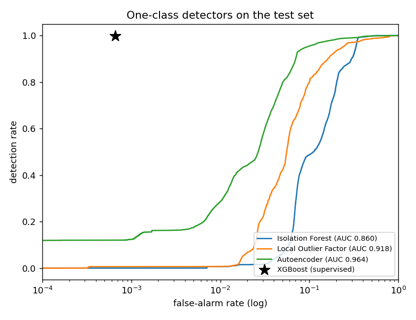
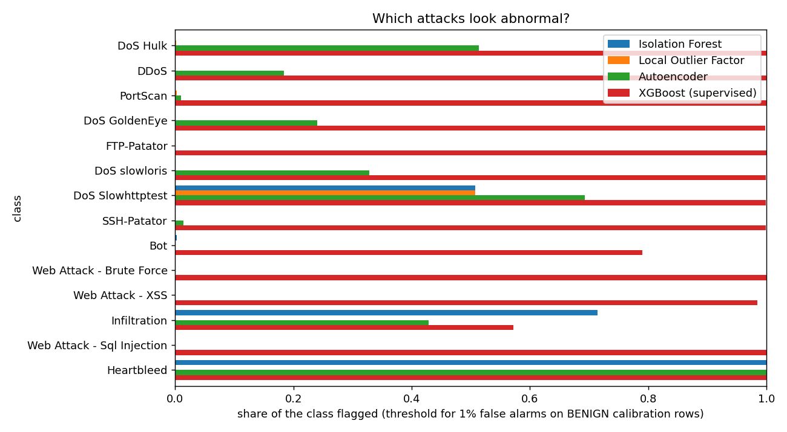
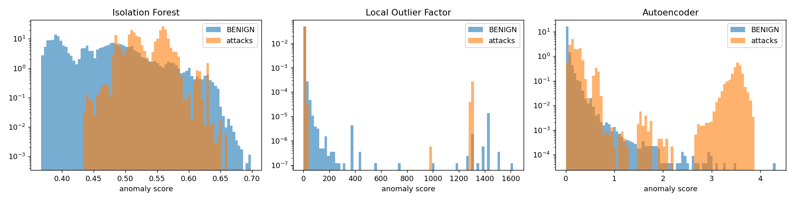

# Unsupervised anomaly detection

Each detector learnt **only BENIGN traffic** (300,000 BENIGN training rows; LOF 50,000). Thresholds were set on 100,000 *other* BENIGN training rows for target false-alarm rates of 0.1%, 1.0%, 5.0%. The test set (504,473 flows, 16.9% attacks) was scored once. No attack label was used to fit or to choose a threshold.

## Overview

DR = detection rate (share of attack flows flagged); FAR = false-alarm rate (share of BENIGN flows flagged). `real FAR` is the false-alarm rate actually measured on the test set at the threshold set for that target.

| detector | fit_rows | roc_auc | average_precision | DR@FAR 0.001 | DR@FAR 0.01 | DR@FAR 0.05 | real FAR@0.001 | real FAR@0.01 | real FAR@0.05 | fit_s | score_s |
|---|---:|---:|---:|---:|---:|---:|---:|---:|---:|---:|---:|
| Isolation Forest | 300000 | 0.8603 | 0.4066 | 0.0001 | 0.0065 | 0.0623 | 0.0009 | 0.0103 | 0.0498 | 1.0000 | 7.0000 |
| Local Outlier Factor | 50000 | 0.9181 | 0.5715 | 0.0063 | 0.0073 | 0.4239 | 0.0010 | 0.0101 | 0.0502 | 12.5000 | 95.9000 |
| Autoencoder | 300000 | 0.9643 | 0.8172 | 0.1230 | 0.2844 | 0.8009 | 0.0009 | 0.0099 | 0.0506 | 110.2000 | 0.5000 |

Supervised reference, XGBoost trained **with** labelled attacks: detection rate 0.9988 at a false-alarm rate of 0.0007.

## Detection per attack class (threshold for 1% false alarms)

| class | test_rows | Isolation Forest | Local Outlier Factor | Autoencoder | XGBoost (supervised) |
|---|---:|---:|---:|---:|---:|
| BENIGN | 419297 | 0.0103 | 0.0101 | 0.0099 | 0.0007 |
| DoS Hulk | 34570 | 0.0004 | 0.0012 | 0.5137 | 0.9999 |
| DDoS | 25603 | 0.0000 | 0.0002 | 0.1838 | 0.9999 |
| PortScan | 18164 | 0.0001 | 0.0024 | 0.0095 | 0.9998 |
| DoS GoldenEye | 2057 | 0.0005 | 0.0005 | 0.2406 | 0.9981 |
| FTP-Patator | 1187 | 0.0000 | 0.0000 | 0.0000 | 1.0000 |
| DoS slowloris | 1077 | 0.0000 | 0.0000 | 0.3287 | 0.9991 |
| DoS Slowhttptest | 1046 | 0.5076 | 0.5076 | 0.6922 | 0.9990 |
| SSH-Patator | 644 | 0.0000 | 0.0000 | 0.0140 | 0.9984 |
| Bot | 391 | 0.0026 | 0.0000 | 0.0000 | 0.7903 |
| Web Attack - Brute Force | 294 | 0.0000 | 0.0000 | 0.0000 | 1.0000 |
| Web Attack - XSS | 130 | 0.0000 | 0.0000 | 0.0000 | 0.9846 |
| Infiltration | 7 | 0.7143 | 0.0000 | 0.4286 | 0.5714 |
| Web Attack - Sql Injection | 4 | 0.0000 | 0.0000 | 0.0000 | 1.0000 |
| Heartbleed | 2 | 1.0000 | 0.0000 | 1.0000 | 1.0000 |

Hardest classes for the best detector (Autoencoder): FTP-Patator, Bot, Web Attack - Brute Force, Web Attack - XSS. These attacks look like normal flows in these features; a detector that only knows normal traffic cannot separate them.

## Reading the results

* A one-class detector needs no attack labels and can in principle flag attacks never seen before; the price is many more false alarms (or missed attacks) than a supervised model that was shown every attack type.
* Volume attacks (DoS, DDoS, PortScan) change flow statistics strongly; slow or application-level attacks (web attacks, some brute force, Bot) look like ordinary sessions.
* The thresholds come from BENIGN *training* rows; the real false-alarm rate on the test set stays close to the target because both are from the same capture. On another network, it would have to be recalibrated.