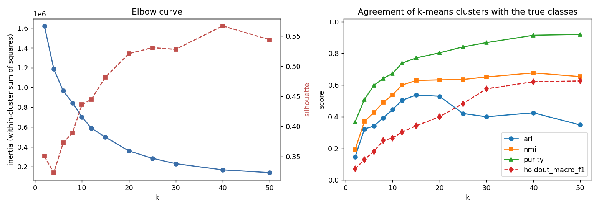
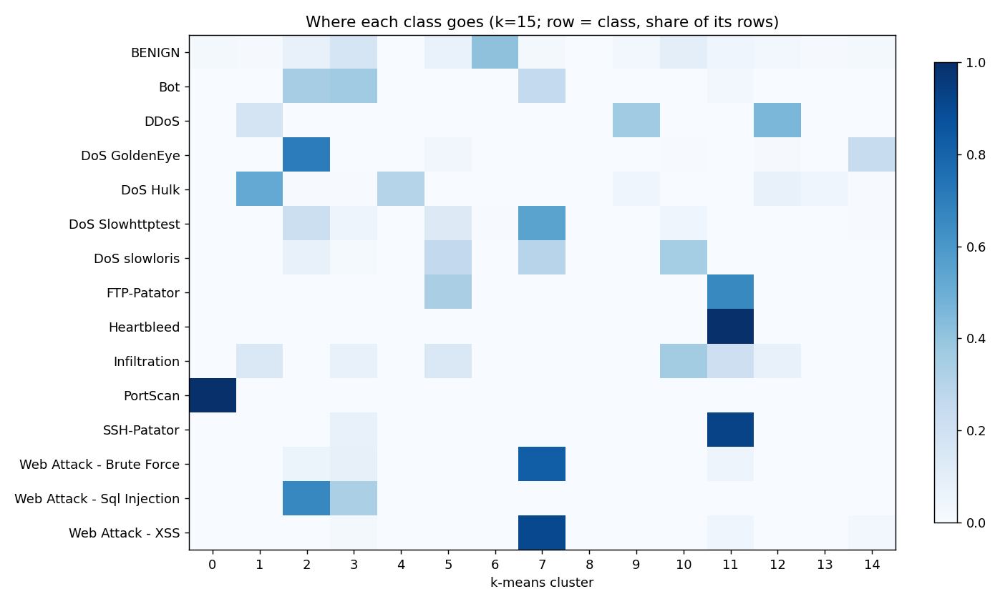
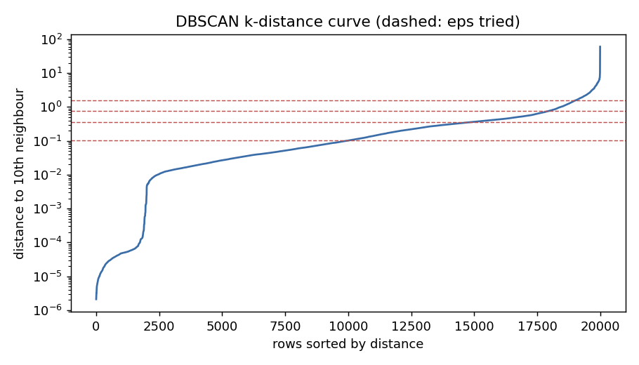

# Clustering of network flows

Sample: 60,000 class-capped **training** rows to fit, 60,000 other training rows to score the cluster-majority classifier; 40 preprocessed features (log + standard scaling). The labels are never used to fit a clustering, only to judge it afterwards. The sample is class-capped, so small attack classes are over-represented compared with real traffic.

## k-means sweep

| k | inertia | silhouette | davies_bouldin | ari | nmi | homogeneity | completeness | purity | holdout_macro_f1 |
|---:|---:|---:|---:|---:|---:|---:|---:|---:|---:|
| 2 | 1620472.1250 | 0.3506 | 1.2809 | 0.1456 | 0.1913 | 0.1283 | 0.3760 | 0.3669 | 0.0703 |
| 4 | 1185959.5000 | 0.3235 | 1.4492 | 0.3220 | 0.3705 | 0.3086 | 0.4635 | 0.5095 | 0.1289 |
| 6 | 964640.2500 | 0.3728 | 1.2425 | 0.3405 | 0.4265 | 0.3921 | 0.4676 | 0.5982 | 0.1808 |
| 8 | 843735.6250 | 0.3897 | 1.2357 | 0.3931 | 0.4906 | 0.4787 | 0.5031 | 0.6419 | 0.2501 |
| 10 | 701125.0625 | 0.4362 | 1.1484 | 0.4454 | 0.5381 | 0.5504 | 0.5263 | 0.6735 | 0.2653 |
| 12 | 588696.8750 | 0.4449 | 1.1300 | 0.5037 | 0.5995 | 0.6315 | 0.5705 | 0.7380 | 0.3030 |
| 15 | 497311.5000 | 0.4818 | 1.0957 | 0.5368 | 0.6290 | 0.6921 | 0.5765 | 0.7714 | 0.3423 |
| 20 | 358481.4062 | 0.5207 | 0.9101 | 0.5291 | 0.6327 | 0.7231 | 0.5624 | 0.8035 | 0.3997 |
| 25 | 283923.1562 | 0.5306 | 0.8425 | 0.4200 | 0.6347 | 0.7653 | 0.5423 | 0.8411 | 0.4826 |
| 30 | 229620.1562 | 0.5278 | 0.9137 | 0.3996 | 0.6511 | 0.8207 | 0.5396 | 0.8679 | 0.5761 |
| 40 | 167430.7344 | 0.5666 | 0.8803 | 0.4247 | 0.6763 | 0.8807 | 0.5490 | 0.9146 | 0.6208 |
| 50 | 138909.1094 | 0.5438 | 0.9539 | 0.3477 | 0.6534 | 0.8897 | 0.5162 | 0.9196 | 0.6262 |

* **silhouette / Davies-Bouldin** use no labels (silhouette: higher is better; Davies-Bouldin: lower is better).
* **ARI, NMI, purity** compare the clusters with the true classes.
* **holdout_macro_f1**: each cluster is named after its majority class (fit rows) and that rule is scored on the evaluation rows.

Best k by silhouette (no labels used): **k = 40** (silhouette 0.567). Best agreement with the classes: k = 15 by ARI, k = 50 by cluster-majority macro F1 (0.626).

## What the clusters contain (k = 15)

4 of 15 clusters are at least 95% one class; 4 are mixed (majority below 60%).

| cluster | size | majority_class | majority_share | second_class | second_share | n_classes_present |
|---:|---:|---|---:|---|---:|---:|
| 0 | 11724 | PortScan | 0.982 | BENIGN | 0.018 | 3 |
| 1 | 8160 | DoS Hulk | 0.740 | DDoS | 0.248 | 4 |
| 12 | 6498 | DDoS | 0.815 | DoS Hulk | 0.131 | 8 |
| 9 | 5069 | DDoS | 0.837 | DoS Hulk | 0.100 | 6 |
| 2 | 4815 | DoS GoldenEye | 0.603 | BENIGN | 0.185 | 10 |
| 6 | 4804 | BENIGN | 0.998 | DoS Slowhttptest | 0.002 | 3 |
| 4 | 3450 | DoS Hulk | 1.000 |  | 0.000 | 1 |
| 11 | 3353 | FTP-Patator | 0.467 | SSH-Patator | 0.354 | 11 |
| 7 | 3002 | DoS Slowhttptest | 0.382 | DoS slowloris | 0.211 | 9 |
| 5 | 2577 | BENIGN | 0.314 | FTP-Patator | 0.311 | 7 |
| 3 | 2551 | BENIGN | 0.750 | Bot | 0.111 | 13 |
| 10 | 1996 | BENIGN | 0.551 | DoS slowloris | 0.380 | 7 |
| 14 | 1370 | DoS GoldenEye | 0.727 | BENIGN | 0.198 | 9 |
| 13 | 629 | DoS Hulk | 0.808 | BENIGN | 0.189 | 3 |
| 8 | 2 | BENIGN | 1.000 |  | 0.000 | 1 |

## k-means vs hierarchical clustering (same rows)

Ward needs O(n^2) memory, so both are scored on the same 10,000 class-capped rows.

| algorithm | n_clusters | ari | nmi | purity | silhouette |
|---|---:|---:|---:|---:|---:|
| k-means (k=15) | 14 | 0.403 | 0.602 | 0.605 | 0.430 |
| Ward agglomerative (k=15) | 15 | 0.452 | 0.630 | 0.658 | 0.525 |

## DBSCAN (density-based)

20,000 rows, min_samples = 10, eps taken at quantiles of the k-distance curve. Noise points (label -1) are not forced into a cluster.

| eps_quantile | eps | n_clusters | noise_fraction | ari | nmi | purity | silhouette |
|---:|---:|---:|---:|---:|---:|---:|---:|
| 0.500 | 0.102 | 79 | 0.466 | 0.205 | 0.587 | 0.628 | 0.730 |
| 0.750 | 0.365 | 138 | 0.190 | 0.358 | 0.668 | 0.865 | 0.698 |
| 0.900 | 0.778 | 102 | 0.081 | 0.449 | 0.722 | 0.939 | 0.699 |
| 0.950 | 1.544 | 84 | 0.039 | 0.473 | 0.733 | 0.943 | 0.707 |

## Limits

* The sample is class-capped; on real traffic proportions BENIGN would dominate every cluster.
* Euclidean distance on scaled log-features is one choice among many; another metric or feature set gives other clusters.
* Silhouette is computed on a random subset of rows (it is O(n^2)).