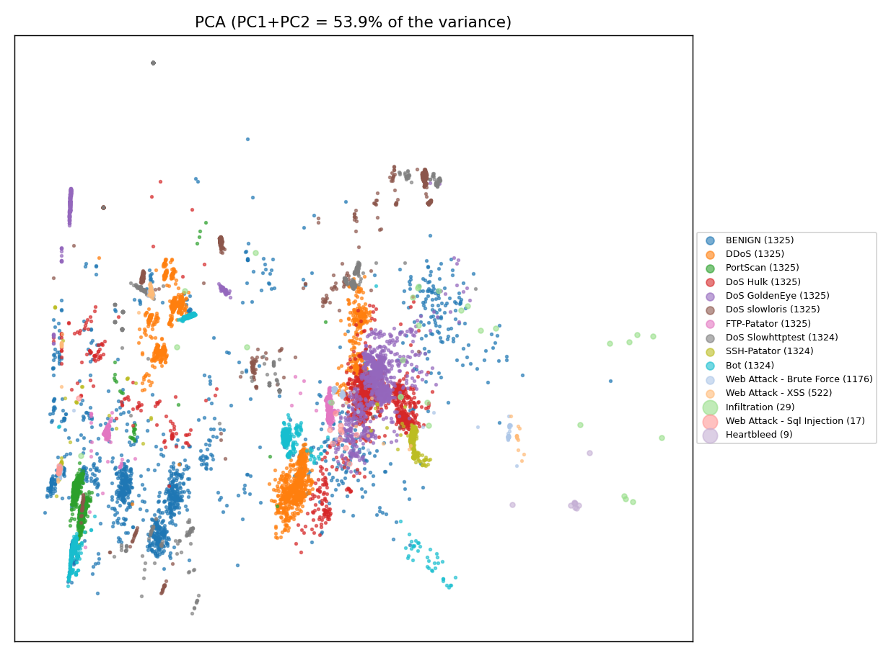
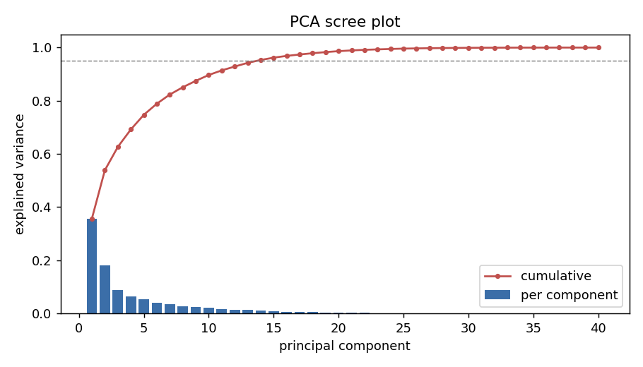
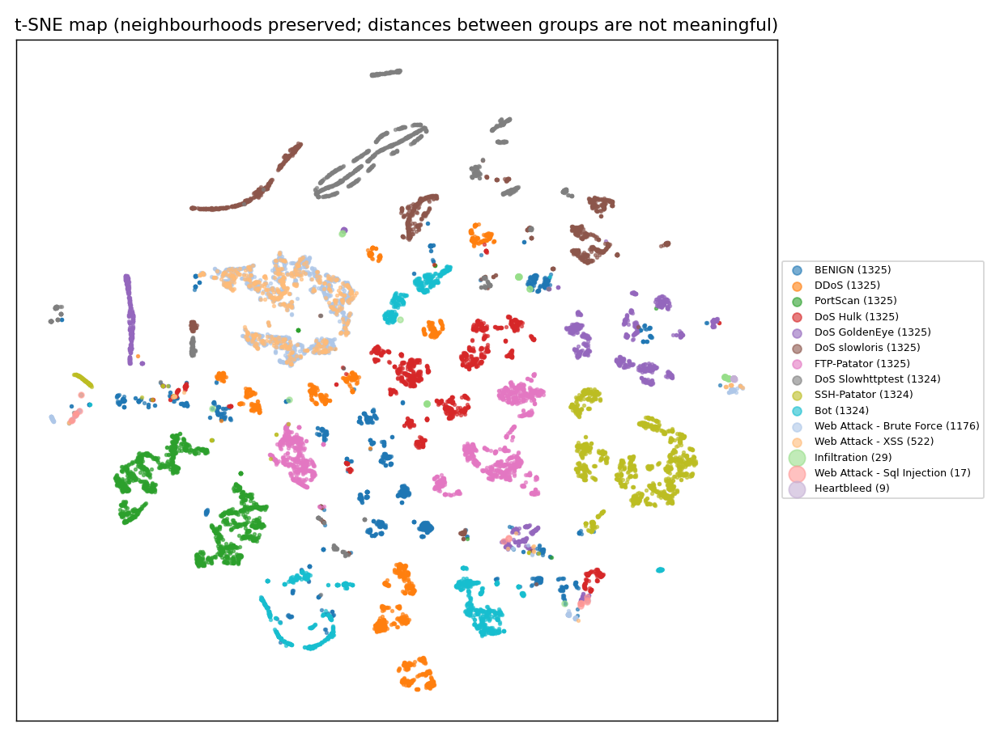
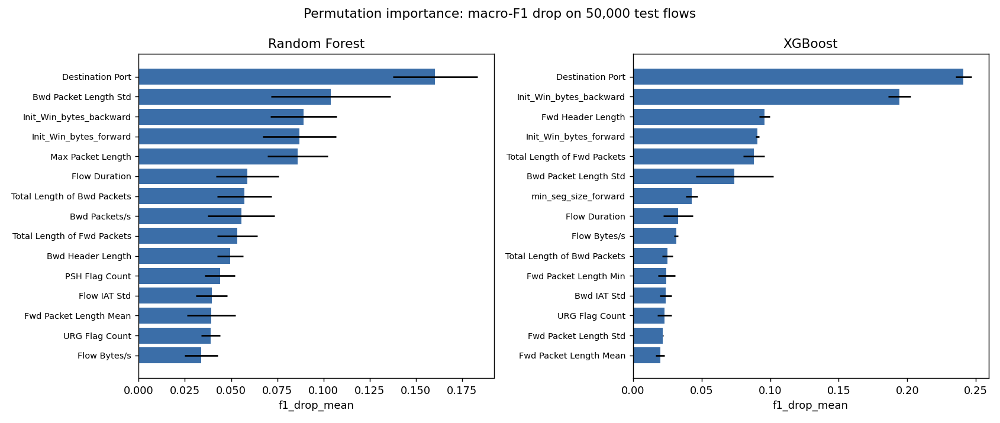
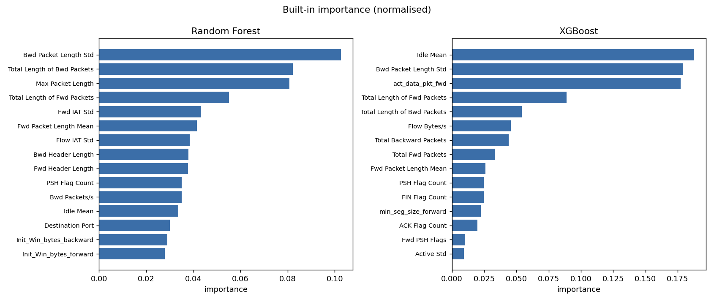

# Projections and feature importance

## PCA

15,000 class-capped training rows, 40 preprocessed features. PC1 and PC2 explain 53.9% of the variance; 11 components are needed for 90% and 14 for 95%, so the classes cannot be fully separated in a 2-D linear view.

Largest loadings of the first two components:

| component | feature | loading |
|---|---|---:|
| PC1 | Total Length of Fwd Packets | 0.288 |
| PC1 | Bwd IAT Total | 0.264 |
| PC1 | Bwd IAT Std | 0.264 |
| PC1 | Max Packet Length | 0.258 |
| PC1 | act_data_pkt_fwd | 0.255 |
| PC2 | Fwd IAT Min | 0.352 |
| PC2 | Idle Std | 0.314 |
| PC2 | Flow Bytes/s | -0.280 |
| PC2 | Active Mean | 0.252 |
| PC2 | Flow IAT Min | 0.250 |

## t-SNE

Same rows. t-SNE keeps neighbourhoods: compact islands of one colour are attack types that are easy to recognise; colours mixed inside one island (for example the web attacks) are the classes the models confuse.

## Feature importance

Models: the saved **baseline** Random Forest and XGBoost (the versions used by the final set). Permutation importance = mean drop of macro F1 when one feature is shuffled (5 repeats) on 50,000 class-capped **test** flows.

Top 10 features by permutation importance:

| Random Forest: feature | Random Forest: f1_drop_mean | XGBoost: feature | XGBoost: f1_drop_mean |
|---|---:|---|---:|
| Destination Port | 0.1604 | Destination Port | 0.2409 |
| Bwd Packet Length Std | 0.1041 | Init_Win_bytes_backward | 0.1942 |
| Init_Win_bytes_backward | 0.0892 | Fwd Header Length | 0.0961 |
| Init_Win_bytes_forward | 0.0869 | Init_Win_bytes_forward | 0.0908 |
| Max Packet Length | 0.0860 | Total Length of Fwd Packets | 0.0882 |
| Flow Duration | 0.0589 | Bwd Packet Length Std | 0.0740 |
| Total Length of Bwd Packets | 0.0571 | min_seg_size_forward | 0.0429 |
| Bwd Packets/s | 0.0556 | Flow Duration | 0.0330 |
| Total Length of Fwd Packets | 0.0535 | Flow Bytes/s | 0.0315 |
| Bwd Header Length | 0.0496 | Total Length of Bwd Packets | 0.0251 |

Agreement between rankings:

* Random Forest: built-in vs permutation share 5 of their top 10; Spearman rank correlation 0.75.
* XGBoost: built-in vs permutation share 4 of their top 10; Spearman rank correlation 0.22.
* Random Forest vs XGBoost (permutation): 7 shared in the top 10; Spearman 0.69.
* `Destination Port` ranks #1 for Random Forest (permutation).
* `Destination Port` ranks #1 for XGBoost (permutation).

## Limits

* Correlated features share importance: shuffling one leaves its partner, so both look less important than the pair is.
* Built-in (impurity / gain) importance favours features with many distinct values and is measured on training data.
* The test slice is class-capped, so the macro F1 weights small classes more than real traffic would.